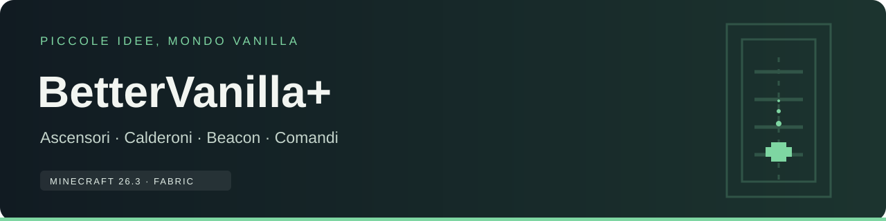

**Minecraft 26.3 · 26.4 Snapshot 7 · Fabric · BetterVanilla+ 1.1.0**

Una raccolta di funzioni ispirate a Vanilla: ascensori costruibili, interazioni con calderoni e beacon e strumenti amministrativi per giocatori e villager.

| 🧱 Costruisci e gioca | ⚙️ Gestisci il mondo |
|---|---|
| [Ascensori](Ascensori) · [Ricette](Ricette) | [Comandi](Comandi) |
| [Calderoni](Calderoni) · [Beacon](Beacon) | [Installazione](Installazione) |
| [Versione 1.1.0](Versione-1.1.0) · [Problemi frequenti](FAQ) | [Compatibilità](Compatibilita) |

## Inizia in tre passi

1. Installa Fabric Loader e Fabric API per la versione Minecraft corrispondente al JAR.
2. Metti BetterVanilla+ nella cartella `mods` sia sul server sia sui client che si collegano. In singleplayer è sufficiente installarlo nel profilo di gioco.
3. Entra nel mondo: crea un ascensore, oppure usa i comandi `/gameset` se hai i permessi necessari.

## Cosa aggiunge

- **Ascensori:** 29 varianti con texture dedicate, ricette individuali, scheda creativa e teletrasporto verticale.
- **Calderoni:** trasforma terra in fango e polvere di cemento in cemento quando vengono gettate in un calderone d’acqua.
- **Beacon:** una mela d’oro su un beacon di livello massimo con Rigenerazione concede Saturazione V ai giocatori vicini.
- **Strumenti di gestione:** KeepInventory individuale e un editor interattivo degli scambi del villager più vicino.

I dettagli pratici, le condizioni e i limiti sono descritti nelle pagine tematiche qui sopra. La [versione 1.1.0](Versione-1.1.0) è disponibile per Minecraft 26.3 e per 26.4 Snapshot 7.

---

[Repository](https://github.com/GoldenRose01/BetterVanilla-) · [Segnala un problema](https://github.com/GoldenRose01/BetterVanilla-/issues) · [Note versione 1.1.0](Versione-1.1.0)
